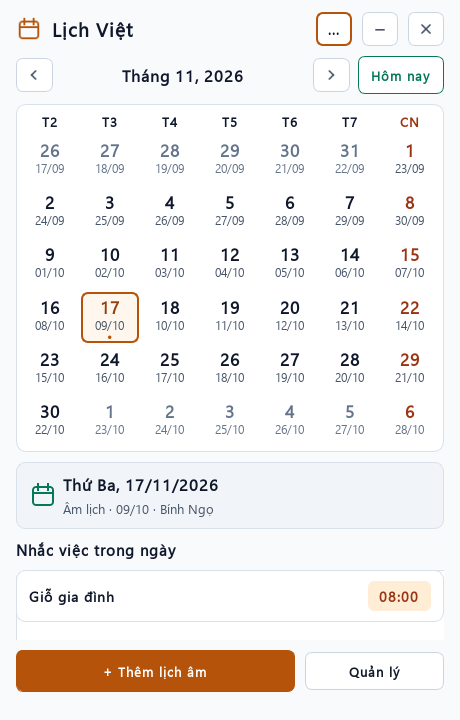
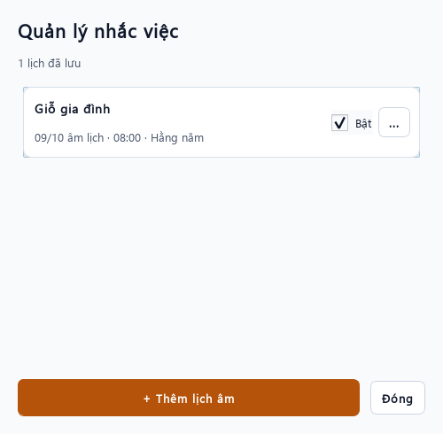

# Lịch Việt

Ứng dụng lịch âm–dương tiếng Việt cho Windows và Android. Xem lịch tháng, tra ngày âm và năm Can Chi, lưu những ngày giỗ hoặc công việc cần nhớ theo âm lịch.

## Giao diện

| Lịch trên PC | Quản lý nhắc việc |
| --- | --- |
|  |  |

Ảnh dùng dữ liệu minh họa, được dựng từ giao diện PC thực tế.

## Chức năng

| Chức năng | Windows | Android |
| --- | --- | --- |
| Xem lịch tháng, chọn ngày, về hôm nay | Có | Có |
| Tra ngày âm, tháng nhuận và năm Can Chi | Có | Có |
| Thêm lịch một lần hoặc lặp hằng năm | Có | Có |
| Bật/tắt, xóa và hoàn tác xóa lịch | Có | Có |
| Thông báo nhắc việc | Khi ứng dụng đang chạy | Chưa hỗ trợ nhắc việc nền |
| Lưu dữ liệu | Tệp JSON trên máy | Cơ sở dữ liệu Room trên thiết bị |

Hai nền tảng dùng quy tắc âm lịch Việt Nam theo UTC+7, hỗ trợ giai đoạn 1900–2199. Ngày 30 và tháng nhuận chỉ áp dụng trong năm có ngày đó. Dữ liệu Windows và Android được lưu riêng, chưa đồng bộ.

## Sử dụng bản đóng gói

Khi repository có bản phát hành, tải gói tương ứng tại mục **Releases**:

- **Windows 64-bit:** giải nén `LichViet-Portable-Windows-x64.zip`, rồi chạy `LichViet.exe`. Không cần cài Python. Đặt ứng dụng trong thư mục có quyền ghi.
- **Android 8.0 trở lên:** cài `LichViet-Android-debug.apk`. APK hiện là bản Debug đã ký để cài thử; chưa nghiệm thu trên điện thoại thật.

Trên Windows, đóng cửa sổ sẽ ẩn ứng dụng xuống khay hệ thống nếu được hỗ trợ. Chọn **Thoát** trong menu để kết thúc. Ứng dụng cần tiếp tục chạy để nhắc việc; bộ kiểm tra lịch chạy mỗi 30 giây.

### Dữ liệu cá nhân

- Khi chạy mã nguồn PC: dữ liệu nằm ở `lunar_reminders.json` trong thư mục dự án.
- Với bản portable: dữ liệu nằm ở `lunar_reminders.json` cạnh `LichViet.exe`.
- Khi chuyển máy hoặc cập nhật ứng dụng, sao lưu và giữ lại tệp JSON của bạn.
- Tệp nhắc việc cá nhân được loại khỏi Git. Gói ZIP dùng để phân phối chứa danh sách nhắc việc rỗng.

## Chạy mã nguồn PC

Yêu cầu **Python 3.10 trở lên**. Tại thư mục gốc dự án trên Windows:

```powershell
python -m venv .venv
./.venv/Scripts/python.exe -m pip install -r requirements.txt
./.venv/Scripts/python.exe -B main.py
```

Giao diện dùng PyQt5. Có thể chọn ngày bằng chuột hoặc dùng phím mũi tên, Enter và Space. Lần đầu chạy, thêm nhắc việc từ nút **Thêm lịch âm**.

## Build bản Windows portable

Thực hiện trên Windows 64-bit, sau khi tạo môi trường Python ở trên:

```powershell
./.venv/Scripts/python.exe -m pip install -r requirements-build.txt
./.venv/Scripts/python.exe -B tools/build_portable.py
./.venv/Scripts/python.exe -B tools/verify_portable.py
```

Kết quả:

```text
output/portable/LichViet.exe
output/LichViet-Portable-Windows-x64.zip
output/portable-verification.json
```

Script kiểm tra khởi động EXE riêng từ một thư mục khác, có tên tiếng Việt. Báo cáo kiểm tra được lưu cùng thư mục đầu ra.

## Build APK Android

Yêu cầu:

- **JDK 17**.
- **Android SDK Platform 35** và **Build Tools 35.0.0**, đã thiết lập giấy phép SDK.
- Python 3 để chạy script build và kết nối mạng cho lần tải thư viện đầu tiên.

Android dùng Kotlin, Jetpack Compose Material 3 và Room. Dự án có Gradle Wrapper 8.11.1, không cần cài Gradle toàn hệ thống.

Từ thư mục gốc, thay các đường dẫn mẫu bằng vị trí JDK và SDK trên máy:

```powershell
./.venv/Scripts/python.exe -B tools/build_android.py --java-home "C:/Android/jdk-17" --sdk "C:/Android/Sdk"
```

Script cũng tự tìm JDK/SDK trong `.tools/` hoặc từ biến môi trường `JAVA_HOME`, `ANDROID_HOME`, `ANDROID_SDK_ROOT`. Script build APK, chạy unit test và Android lint, sau đó kiểm tra chữ ký và manifest.

Kết quả:

```text
output/android/LichViet-Android-debug.apk
output/android/verification.json
```

Có thể mở thư mục `android/` bằng Android Studio, hoặc chạy trực tiếp sau khi thiết lập JDK/SDK:

```powershell
cd android
./gradlew.bat :app:assembleDebug :app:testDebugUnitTest :app:lintDebug
```

## Kiểm thử

```powershell
./.venv/Scripts/python.exe -B -m unittest discover -s tests -v
./.venv/Scripts/python.exe -B tools/render_desktop.py
```

Kiểm thử PC sử dụng tệp tạm, không thay đổi nhắc việc cá nhân. Ảnh giao diện được xuất vào `output/desktop/`.

Lần kiểm tra gần nhất:

- **16 bài Python đạt:** thao tác bàn phím, biểu mẫu, lưu lỗi, hoàn tác xóa, tiêu đề dài, chống nhắc trùng, đường dẫn portable, bảo vệ dữ liệu và gói ZIP không kèm nhắc việc cá nhân.
- **4 bài Kotlin đạt** khi chạy qua Gradle; APK build thành công và Android lint không có lỗi.
- Kiểm tra đổi ngày khứ hồi trong giai đoạn 1900–2199; đối chiếu Python/Kotlin trên **109.573 ngày** không có sai khác.

Các kiểm tra tự động chưa thay thế nghiệm thu trên thiết bị Android thật. Thông báo và khay hệ thống Windows cũng cần kiểm tra trực tiếp trên máy sử dụng.

## Cấu trúc mã nguồn

```text
main.py
core/
ui/
assets/
android/
tools/
tests/
docs/images/
```

`core/` xử lý âm lịch và lưu JSON; `ui/` và `assets/` tạo giao diện PC. `android/` chứa ứng dụng di động; `tools/` cung cấp script build và kiểm tra. Bộ kiểm thử Python nằm trong `tests/`.

Thư mục công cụ cục bộ, môi trường Python, cache và tệp build được loại khỏi Git. Các bản EXE, ZIP và APK phù hợp để đính kèm vào **GitHub Releases** thay vì lưu trong mã nguồn.
